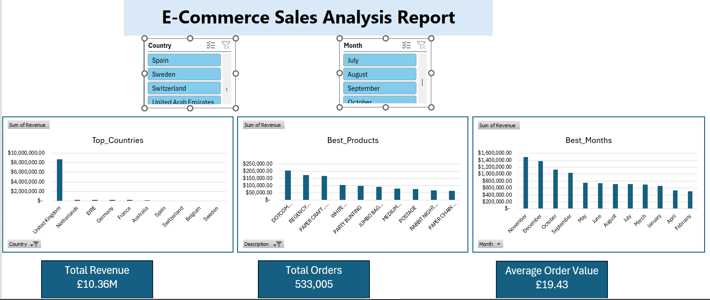

E-Commerce Sales Analysis Dashboard

Overview
This project analyzes a real-world e-commerce sales dataset containing over 500,000 transactions. The objective was to identify key sales trends, top-performing products, customer purchasing behavior, and regional sales performance using Microsoft Excel.
The project includes data cleaning, Pivot Tables, Pivot Charts, KPI metrics, slicers, and an interactive dashboard.
________________________________________
Business Questions
1. Best Products
Identified the top-selling products based on total revenue generated.
2. Best Months
Analyzed monthly sales performance to determine peak sales periods.
3. Top Countries
Examined country-level revenue contributions to identify the strongest markets.
4. Repeat Buyers
Identified customers who made multiple purchases to understand customer loyalty.
5. Average Order Value (AOV)
Calculated the average revenue generated per transaction.
________________________________________
Data Cleaning
The following data preparation steps were performed:
•	Removed cancelled transactions (Invoice IDs beginning with "C")
•	Reviewed customer records
•	Created a Revenue field using:
Plain Text
Revenue = Quantity × Price
•	Prepared data for Pivot Table analysis
________________________________________
Dashboard Features
•	Interactive Country Slicer
•	Interactive Month Slicer
•	Top Products Analysis
•	Monthly Revenue Analysis
•	Country Revenue Analysis
•	KPI Cards
KPI Metrics
Metric	Value
Total Revenue	£10.36M
Total Orders	533,005
Average Order Value	£19.43
________________________________________
Key Insights
•	November generated the highest sales revenue.
•	The United Kingdom was the strongest revenue-generating market.
•	Several customers demonstrated strong repeat purchase behavior.
•	A small number of products contributed significantly to overall revenue.
•	Average Order Value was £19.43 per transaction.
________________________________________
Tools Used
•	Microsoft Excel
•	Pivot Tables
•	Pivot Charts
•	Slicers
•	Dashboard Design
•	Data Cleaning
________________________________________
Author
Anvar Data Analytics & Business Intelligence Enthusiast
